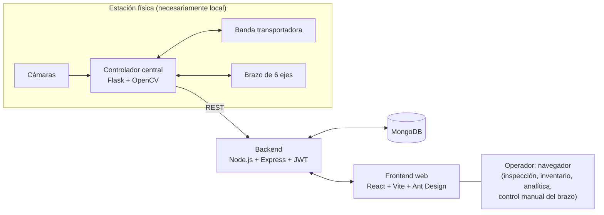

# Análisis del proyecto de referencia 2024

Fase 4 (letra F del documento maestro). Responde las nueve preguntas del documento maestro sobre la presentación de 2024 [F-059]. El contenido de la presentación está en [[contenido-presentacion-2024]] y la comparación técnica entre nube y procesamiento local en [[comparacion-nube-vs-edge]]. Premisa del documento maestro: **no** se trata de reconstruir ese proyecto.

## 0. Lo más importante

1. `#inferencia` **Lo que se demostró no es inspección de semiconductores.** Es un demostrador de integración (cámaras, aplicación web, inventario, banda transportadora y brazo robótico) probado con una tarjeta PCB educativa sin componentes y con defectos simulados (un papel con una X roja). Se apoya en los videos de la diapositiva 7 ([[contenido-presentacion-2024]] §4).
2. `#hecho` **No hay evidencia de desempeño.** La presentación no muestra dataset, clases de defecto, métricas ni línea base, y no nombra ningún modelo de IA: la visión se describe solo como OpenCV [F-059, diap. 6].
3. `#hecho` **La justificación no tiene fuentes.** Las referencias tratan de prótesis de miembro superior, no del tema [F-059, diap. 11]. El "20-30 %" parece una lectura equivocada de un dato real: los inspectores humanos suelen pasar por alto entre 20 y 30 % de los defectos [F-060]. No se encontró fuente para las pérdidas de "$2 billion".
4. `#inferencia` **Ya era una arquitectura híbrida.** La nube se usaba para guardar y mostrar resultados (API, base de datos y tableros). El controlador que mueve la banda y el brazo tenía que estar junto al hardware. La pregunta de 2026 no es "nube o Raspberry Pi" en bloque, sino **dónde poner cada función**: [[comparacion-nube-vs-edge]].
5. `#inferencia` **Lo reutilizable son ideas, no piezas:**
   - el etiquetado con un humano en el ciclo (botones "Bien" y "Defectuoso");
   - los modos manual y automático, útiles para compararse contra una línea base humana;
   - la trazabilidad por tipo de producto y los reportes.

   El brazo robótico no ayuda a responder una pregunta de investigación y sí agrega costo y riesgo.
6. **Desde 2024 cambió el contexto:**
   - `#hecho` En Puebla ya hay un posible usuario real: Yankuilotl, que ensambla tarjetas desde 2026 [F-040].
   - `#hecho` La combinación "Raspberry Pi + YOLO" para inspeccionar tarjetas ya está publicada [F-054].
   - `#hecho` El hardware local mejoró, pero se encareció. Por ejemplo, la Raspberry Pi 5 de 8 GB pasó de 80 a ≈ 175 USD [F-067, F-068].
   - `#hecho` Ya hay regiones de nube en Querétaro [F-070 a F-072].
7. `#pregunta` **La autoría decide cómo citarlo.** La tarjeta con el logotipo de MIRAI y las fechas de los videos (octubre a diciembre de 2024) apuntan a una estancia en Mirai Innovation [F-075]. El documento maestro dice que Fortino e Israel estuvieron en Japón mediante MIRAI. Falta saber si son autores (Q-023): de eso depende el formato FE-07 (§12).

## 1. Qué problema intentaba resolver

| Nivel | Contenido | Tipo |
|---|---|---|
| Problema declarado | Ineficiencia y errores de la inspección manual y de la clasificación de circuitos defectuosos en la manufactura de semiconductores; además, control de inventario de circuitos aceptados y rechazados | `#hecho` [F-059, diap. 3, 8] |
| Usuario declarado | "Fabricantes de semiconductores" en general | `#hecho` [F-059, diap. 3] |
| Lo que el prototipo resolvió | Capturar imágenes de tarjetas, registrar a mano o en automático "bien/defectuoso", mover y clasificar con un brazo robótico, y llevar conteos por tipo de circuito con tableros y reportes | `#hecho` [F-059, diap. 7] |
| Brecha | El problema y el usuario son genéricos y no corresponden al objeto probado: tarjetas, no obleas ni chips. No hay evidencia de que alguien concreto tenga ese problema | `#inferencia` |

## 2. Arquitectura propuesta

Reconstrucción propia a partir de la diapositiva 6 y de los videos. No es copia del diagrama original.

- `#hecho` Tres capas con responsabilidades separadas: frontend, backend con autenticación JWT y controlador central que habla directamente con el hardware [F-059, diap. 6].
- `#inferencia` La captura y el procesamiento de imagen (OpenCV) y el control de actuadores corrían junto al hardware. La "nube" correspondía al backend, la base de datos y los tableros. En los videos la aplicación se abre por una dirección IP con puerto, sin dominio, así que no se puede saber si estaba en la nube o en la red local (Q-041).
- `#hecho` La interfaz incluye un botón de "Parada de emergencia" y control manual de las seis articulaciones desde el navegador [F-059, diap. 7].

## 3. Tecnologías

| Capa | Tecnología | Papel | Comentario 2026 (`#inferencia`) |
|---|---|---|---|
| Visión | OpenCV (en el controlador) | Captura y procesamiento de imagen | No se sabe si hubo un modelo entrenado (Q-040). En 2026 hay detectores optimizados para CPU de bajo consumo [F-061, F-062] |
| Controlador | Flask (Python) | Endpoints REST para banda y brazo | Funciona para prototipos. Un control de actuadores necesita además paro físico y lógica de seguridad independiente del navegador |
| Backend | Node.js, Express, JWT | API, reglas de negocio, autenticación | Estándar; ninguna novedad que defender ante jueces |
| Datos | MongoDB | Resultados e inventario | Para registro de inspecciones, cualquier base de datos sirve. Lo que importa es el esquema de trazabilidad |
| Frontend | React, Vite, Ant Design | Inspección, inventario, analítica, control del brazo | Igual que el backend |
| Hardware | Cámaras, banda, brazo de 6 ejes con succión | Mover y clasificar tarjetas | El brazo no responde una pregunta de investigación; suma costo, tiempo y riesgo |

## 4. Supuestos

| Supuesto (explícito o implícito) | Tipo | Estado con la evidencia de 2026 |
|---|---|---|
| La inspección manual es el gran problema de la manufactura de semiconductores | `#supuesto` | No verificado. La revisión manual sí falla en ensamble electrónico [F-051, F-060], pero en Puebla no hay fabricación de chips (ver [[sintesis-fase-3]]) y no se sabe cómo inspecciona Yankuilotl (Q-034) |
| Una cámara con OpenCV detecta los defectos relevantes | `#supuesto` | No demostrado: los defectos eran simulados y no se reportan resultados |
| Automatizar con un robot aporta valor | `#supuesto` | No evaluado; no hay comparación de tiempos ni costos |
| Hay conectividad a la nube y la planta la permite | `#supuesto` | No se discute. La guía de NIST para tecnología operacional recomienda segmentar y separar la red de producción de las redes corporativas e internet [F-074 §5]; además, las imágenes pueden ser confidenciales (Q-043) |
| Un cliente pagaría 19,000 USD o 8,000 USD al año | `#supuesto` | Sin validación de mercado |
| El sistema se adapta a otras inspecciones e industrias | `#supuesto` | La literatura señala la generalización entre tarjetas distintas como un reto abierto [F-052] |
| Funciona "en tiempo real" | `#supuesto` | Sin mediciones de latencia ni de rendimiento |

## 5. Limitaciones observadas

1. **Desajuste de alcance:** se titula "semiconductores" y describe fabricación de obleas (diap. 4 y 9), pero prueba tarjetas PCB sin componentes.
2. **Defectos simulados:** el "defectuoso" del video es un papel con una X roja; no hay taxonomía de defectos ni relación con normas como IPC-A-610.
3. **Sin método de evaluación:** no hay dataset descrito, conjunto de prueba, métricas, línea base humana ni análisis estadístico.
4. **Datos de demostración:** las proporciones de defectuosos van de 24 % a 58 % según el tipo de tarjeta, propias de una demostración y no de producción (`#inferencia`). El resumen de inspección no se puede conciliar con el inventario.
5. **Referencias ajenas al tema** y cifras sin fuente (§7).
6. **Seguridad:**
   - la aplicación se sirve por HTTP sin cifrar;
   - el brazo se mueve desde el navegador;
   - el "paro de emergencia" es un botón en pantalla.

   `#inferencia` En una máquina real, el paro de emergencia debe ser un dispositivo físico que no dependa del software. Hay que verificar la norma aplicable si el proyecto 2026 tuviera actuadores.
7. **Plan de negocio sin supuestos explícitos** (mercado, costos de operación, márgenes).
8. **"Siguientes pasos" genéricos:** más IA, más analítica, más industrias.

## 6. Prueba del documento maestro: "si proponemos visión por computadora, debemos poder justificar…"

| Pregunta del documento maestro | Qué responde la presentación 2024 | Valoración (`#inferencia`) |
|---|---|---|
| Qué se necesita detectar | "Circuitos defectuosos", sin definir defectos | ✗ |
| Quién necesita detectarlo | "Fabricantes de semiconductores" en general | ✗ |
| Cómo se hace actualmente | Cámaras de barrido lineal y SWIR para obleas (no es el proceso del prototipo) | ✗ |
| Qué problema tiene el método actual | Cifras sin fuente (§7) | ✗ |
| Qué datos se necesitan | No se menciona | ✗ |
| Qué métrica demostraría que funciona | No se menciona | ✗ |
| Qué hardware sería suficiente | Se usó brazo, banda y cámaras, sin justificar por qué ese hardware | ~ |
| Qué limitaciones tendría | Solo las de las cámaras comerciales, no las propias | ✗ |
| Por qué la propuesta aporta algo | Integración de visión, robótica y nube | ~ (en 2026 la integración por sí sola ya no es novedad [F-054]) |

Esta tabla sirve como **lista de control** para nuestras propias ideas candidatas en la Fase 5.

## 7. Afirmaciones cuantitativas y su verificación

| Afirmación de la presentación | Fuente en la presentación | Verificación (2026-10-01) | ¿Se puede usar? |
|---|---|---|---|
| "20-30% of electronic circuits fail during manual inspections" | Ninguna | Hay un dato parecido pero distinto: "for most inspection tasks, missed defects typically range from 20% to 30%" [F-060]. Mide cuántos defectos **no detecta** el inspector humano, no cuántos circuitos fallan. Un proveedor de AOI da un orden similar (≈ 30 % de errores reales no detectados en revisión manual) [F-051] | Solo bien formulado, citado y si nuestro problema involucra inspección visual humana |
| "Annual losses of up to $2 billion" por inspección manual en semiconductores | Ninguna | No se encontró fuente en una búsqueda web | No |
| Inversión de 12,630 USD y precios de venta | Estimación interna | Sin desglose de supuestos | No como evidencia |

## 8. Qué sigue vigente en 2026

- `#hecho` La inspección visual humana sigue siendo falible [F-060] y la inspección automática en ensamble electrónico tiene retos abiertos: falsas alarmas, generalización entre modelos de tarjeta y escasez de datos [F-051, F-052].
- `#inferencia` Separar el control en tiempo real (local) del registro y la visualización (local o remota) sigue siendo un buen patrón. Es la base de cualquier opción híbrida ([[comparacion-nube-vs-edge]]).
- `#inferencia` La idea de convertir cada decisión del operador en una etiqueta para formar un dataset propio es aún más valiosa hoy: los datasets abiertos de tarjeta ensamblada siguen siendo escasos ([[estudios-existentes]]).
- `#inferencia` La trazabilidad por tipo de producto puede ser relevante para una planta nueva de alta mezcla (OP-04), si Yankuilotl lo confirma (Q-036).
- `#hecho` El equipo ya sabe integrar visión, web, nube y robótica: no necesita demostrarlo otra vez; el diferenciador debe ser el rigor.

## 9. Qué cambió desde 2024

| Cambio | Desde | Implicación para nosotros | Fuente |
|---|---|---|---|
| Puebla tiene una planta estatal de ensamble de tarjetas (Yankuilotl) y laboratorios Kutsari de caracterización y validación de chips | ≈ abr 2026 y may 2026 | Puede haber un **usuario local real**, que en 2024 no existía | F-040, F-044 |
| "Raspberry Pi 5 + YOLO" para inspeccionar tarjetas ya está publicado | 2026 | La integración no basta para ser original (B1) | F-054 |
| Más datos y referencias de evaluación: DsPCBSD+ (tarjeta desnuda) y MVTec AD 2 (detección de anomalías). En MVTec AD 2 los mejores métodos quedan por debajo de 60 % de AU-PRO en escenarios difíciles | 2024–2025 | Hay datos para pruebas iniciales; la detección sin ejemplos de defectos no está resuelta | F-055, F-076 |
| YOLO26: sin supresión de no máximos (NMS) y hasta 43 % más rápido en CPU que YOLO11n; licencia AGPL-3.0 o empresarial | ene 2026 | Modelos más ligeros para edge; revisar la licencia si se publica código | F-062 |
| En Raspberry Pi 5, YOLO26n tarda ≈ 67 ms por imagen a 640 px (formato NCNN, FP32) | 2026 | La inferencia local en CPU es viable para ciclos de segundos | F-061 |
| Aceleradores accesibles: AI Camera con IMX500 (70 USD), AI HAT+ de 13 y 26 TOPS (70 y 110 USD), Jetson Orin Nano Super con 67 TOPS (249 USD) y AI HAT+ 2 con 40 TOPS INT4 (130 USD; en visión rinde como el de 26 TOPS) | sep 2024 – ene 2026 | Más opciones edge que en 2024 | F-063 a F-066 |
| Precios de Raspberry Pi al alza por la escasez de memoria: 4 GB de 60 a ≈ 110 USD, 8 GB de 80 a ≈ 175, 16 GB de 120 a 305 | dic 2025 – abr 2026 | El edge ya no es tan barato. Conviene usar el hardware que el equipo ya tiene | F-067 a F-069 |
| Regiones de nube en Querétaro: Azure México Central, Google Cloud Querétaro y AWS México Central (3 zonas) | may 2024 – ene 2025 | Menor latencia y datos dentro del país, si se usa nube | F-070 a F-072 |
| Reglas del certamen: la FEMECI-PUEBLA 2026 da 50 puntos al protocolo (A) y descalifica por plagio total o parcial | 2026 | Un demostrador sin método no compite; la originalidad debe ser clara | F-001 |

## 10. Qué podríamos reutilizar conceptualmente

| Concepto | Por qué sirve en 2026 | Condición |
|---|---|---|
| Humano en el ciclo: cada "Bien" o "Defectuoso" del operador se guarda como etiqueta | Forma un dataset propio y da una línea base humana para comparar (A4, A5) | Acceso a tarjetas reales y permiso de uso (Q-037) |
| Modo manual y modo automático en la misma estación | Permite diseñar un experimento comparativo (humano, modelo, humano asistido) | Protocolo definido antes de medir |
| Trazabilidad por tipo de producto con marca de tiempo | Responde a una planta de alta mezcla (OP-04) | Que Yankuilotl confirme la necesidad (Q-036) |
| Reporte exportable de cada sesión de inspección | Evidencia para el expediente y la bitácora (C3) | — |
| Control en tiempo real local; registro y tableros separados | Base de una arquitectura híbrida | Decidir con el experimento de [[comparacion-nube-vs-edge]] |
| Paro de emergencia como requisito | Obligado si hay actuadores | Debe ser físico, no solo en pantalla |

**No reutilizar:**
- el planteamiento "semiconductores" para un prototipo de tarjetas;
- las cifras de la justificación, las referencias y el plan de negocio;
- el brazo robótico, salvo que el problema lo exija;
- textos, figuras o código, mientras no se aclare la autoría (§12).

## 11. Qué haríamos diferente

| Aspecto | Proyecto 2024 | Cómo lo haríamos en 2026 | Criterio |
|---|---|---|---|
| Problema | Genérico ("fabricantes de semiconductores") | Problema verificado en una planta o laboratorio poblano, con evidencia de entrevista y datos. Si no se consigue acceso, cambiar de familia (ver [[sintesis-fase-3]]) | A1, A2 |
| Nombre y alcance | "Semiconductores", probado con tarjetas | Nombrar lo que es (por ejemplo, inspección en ensamble electrónico) | A1, C2 |
| Hipótesis | Objetivos de construcción | Hipótesis o metas medibles: por ejemplo, "sensibilidad ≥ X con falsas alarmas ≤ Y y latencia ≤ Z" (valores por definir con el usuario) | A3 |
| Datos | No documentados; defectos simulados | Defectos reales; clases alineadas con IPC-A-610; ficha del dataset con procedencia, licencia y permisos | A4, B3 |
| Evaluación | Sin métricas | Precisión, sensibilidad, F1 y matriz de confusión por clase; intervalos de confianza; línea base humana; conjunto de prueba independiente | A4, A5 |
| Hardware | Brazo de 6 ejes y banda | Solo lo necesario para responder la pregunta. Probablemente basta un soporte fijo con iluminación controlada (`#inferencia`) | A4, viabilidad |
| Cómputo | Nube para registro, sin justificar | Decidir nube, local o híbrido **con un experimento** ([[comparacion-nube-vs-edge]]) | A4, B2 |
| Seguridad | HTTP; brazo y paro de emergencia desde el navegador | HTTPS, autenticación, red segmentada; paro físico si hay actuadores | B3 |
| Referencias | Ajenas al tema | Estado del arte pertinente y verificable, en APA 7 ([[estudios-existentes]]) | A5 |
| Proceso | Sin bitácora visible | Bitácora diaria, git, uv y registro de experimentos | C3 |
| Impacto | Plan de negocio sin supuestos | Impacto con supuestos explícitos. La rúbrica evalúa pertinencia e impacto, no un plan de negocio | A2 |

## 12. Originalidad, autoría y continuidad

**Lo que sabemos:**
- `#hecho` La presentación no nombra a sus autores, lleva "Confidential" en todas las diapositivas y el logotipo de MIRAI aparece en la portada y en la tarjeta inspeccionada [F-059].
- `#hecho` Mirai Innovation Research Institute (Osaka, Japón) ofrece estancias de investigación de 4 a 12 semanas en IA y visión por computadora, robótica, realidad virtual y aumentada, y neurotecnología, con presentación final [F-075].
- `#hecho` Según el documento maestro, Fortino e Israel participaron en una experiencia en Japón mediante MIRAI.
- `#inferencia` La leyenda "Confidential" puede venir de la plantilla del programa. Aun así, se trata como confidencial hasta saber lo contrario.

**Escenarios:**

| Escenario | Qué implica | Qué hacer |
|---|---|---|
| Fortino o Israel son autores, y el proyecto 2026 continúa el de 2024 | Probable proyecto de continuidad | Llenar FE-07 y declarar qué es nuevo [F-001 §5.1]; consultar a la DME (Q-011) |
| Fortino o Israel son autores, y el proyecto 2026 es otro (otro problema, datos y método) | Probablemente no es continuidad, pero hay antecedente propio | Mencionarlo como antecedente en el protocolo; confirmar con la DME (Q-011) |
| No son autores | Trabajo de terceros | Si se menciona, citarlo como antecedente. No reutilizar texto, figuras, código ni datos sin permiso; diferenciarse con claridad (§9.1, F-04) |

En todos los casos:
- no usar sus cifras ni sus referencias;
- no mostrar la presentación en el certamen sin permiso (por la leyenda "Confidential");
- mantener esta comparación en la bitácora como evidencia de que el proyecto 2026 se construyó de forma independiente.

## 13. Cómo le iría con la rúbrica de 2026 (`#inferencia`)

Sirve para no repetir errores, no para juzgar a sus autores. El proyecto se hizo en otro contexto: una estancia corta, sin la rúbrica de la FEMECI.

| Criterio | Tal como está | Qué haría falta |
|---|---|---|
| A1 Problema | Débil: genérico | Problema local verificado |
| A2 Pertinencia | Débil: cifras sin fuente | Evidencia citada y usuario real |
| A3 Hipótesis/metas | Débil: no medibles | Metas cuantitativas |
| A4 Metodología | Media: el diseño técnico está descrito, el de pruebas no | Protocolo experimental |
| A5 Análisis y referencias | Débil: sin datos y con referencias ajenas | Resultados con métricas y estado del arte pertinente |
| B1 Originalidad | Débil en 2026: la integración ya está publicada | Problema, datos y validación propios |
| B3 Ética de la información | Riesgo: referencias ajenas | Citas correctas y permisos |

## 14. Preguntas abiertas

| ID | Pregunta | A quién |
|---|---|---|
| Q-023 | ¿Fortino o Israel son autores o coautores del proyecto 2024? ¿Quién más participó? ¿Se presentó en algún certamen? | Equipo |
| Q-040 | ¿Qué técnica de visión se usó (procesamiento clásico con OpenCV o un modelo entrenado)? ¿Hubo defectos reales y métricas? | Autores (vía Fortino) |
| Q-041 | ¿Dónde corría cada componente (controlador, backend, base de datos): en la red local o en la nube? | Autores (vía Fortino) |
| Q-042 | ¿La leyenda "Confidential" es una restricción real de Mirai o de los autores? ¿Se puede citar o mostrar algo de la presentación? | Autores o Mirai (vía Fortino) |

Registradas en [[preguntas-abiertas-convocatoria]] (Q-023) y [[preguntas-pendientes]] (Q-040 a Q-042).
